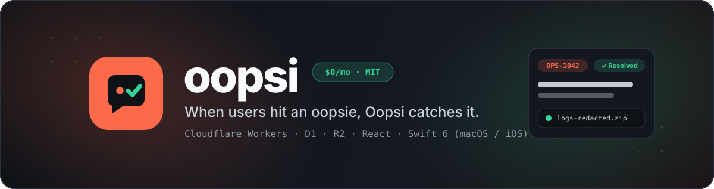
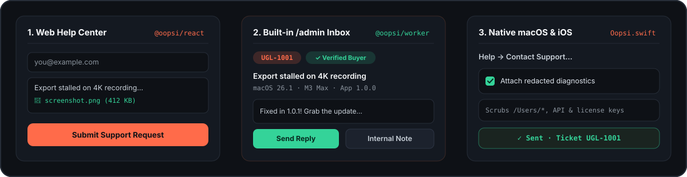
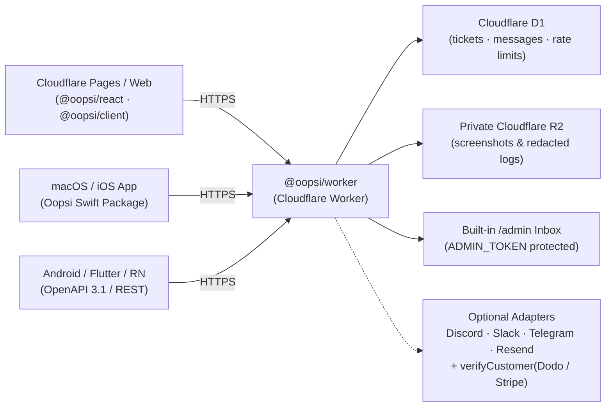

<p align="center">
  <picture>
    <source media="(prefers-color-scheme: dark)" srcset="./assets/banner-dark.svg" />
    <source media="(prefers-color-scheme: light)" srcset="./assets/banner-light.svg" />
    
  </picture>
</p>

<p align="center">
  <strong>When users hit an oopsie, Oopsi catches it.</strong><br />
  A drop-in, <strong>$0/month</strong> Cloudflare-native support desk for <strong>Web</strong>, <strong>macOS</strong>, <strong>iOS</strong>, and <strong>mobile apps</strong>.<br />
  <sub>No VPS · No MySQL · No per-seat SaaS bills · 100% Cloudflare Free Tier (Workers + D1 + R2)</sub>
</p>

<p align="center">
  <a href="./LICENSE"></a>
  <a href="https://developers.cloudflare.com/workers/"></a>
  <a href="./packages/worker"></a>
  <a href="./swift"></a>
  <a href="./docs/openapi.yaml"></a>
</p>

<p align="center">
  <a href="#-set-up-in-2-minutes-with-any-ai-agent">AI Agent Setup</a> ·
  <a href="#-3-minute-quick-start">Quick Start</a> ·
  <a href="#-packages">Packages</a> ·
  <a href="#-why-oopsi">Why Oopsi</a> ·
  <a href="#-drop-in-examples">Examples</a> ·
  <a href="#-built-in-adapters">Adapters</a> ·
  <a href="./docs/self-hosting.md">Self-Hosting Guide</a> ·
  <a href="./ROADMAP.md">Roadmap</a> ·
  <a href="./CONTRIBUTING.md">Contributing</a>
</p>

---

<p align="center">
  
</p>

## Why Oopsi?

Indie developers shipping **macOS, iOS, Android, or Web apps** shouldn't have to pay **\$50–\$99/month** for Intercom/Zendesk — or babysit a PHP/MySQL server for osTicket.

**Oopsi** runs entirely on **Cloudflare Workers + D1 + R2** (100% free tier — no Queues, no Durable Objects, no VPS) and ships first-class libraries so users can submit concerns straight from your **Cloudflare Pages site**, **native Mac/iOS app**, or **mobile app**.

| Feature | **Oopsi** | Intercom / Zendesk | osTicket | Other CF Helpdesks |
|---|:---:|:---:|:---:|:---:|
| **Monthly cost (solo / indie)** | **\$0/mo** *(CF Free Tier)* | \$29–\$99+/seat | VPS + MySQL | Often \$5+/mo *(Queues/DO)* |
| **Zero-config `/admin` inbox UI** | Yes | Yes | Yes | Mixed |
| **Private R2 attachments (XSS-sandboxed)** | Yes | Yes | Local disk | Mixed |
| **Drop-in React components (`@oopsi/react`)** | Yes | Widget only | No | Standalone app |
| **Native Swift 6 Package (`macOS` / `iOS`)** | Yes + PII Redactor | Heavy SDK | No | No |
| **OpenAPI 3.1 spec (Android / Flutter / Go)** | Yes | Proprietary | Limited | Rarely |
| **Pluggable billing check (Dodo / Stripe)** | 5-line hook | Paid tier | No | No |
| **License** | **MIT** | Proprietary | GPL-2.0 | Source-available / MIT |

---

## Packages

| Package | Target | Description |
|---|---|---|
| [`@oopsi/worker`](./packages/worker) | Cloudflare Workers | Core ticketing engine, D1 SQLite migrations, R2 attachment streaming, rate limiting, built-in `/admin` inbox, and notification/email adapters. |
| [`@oopsi/client`](./packages/client) | Web · RN · Expo · Electron · Node | Tiny (~3 kB), zero-dependency TypeScript client for creating tickets, uploading attachments, and posting replies. |
| [`@oopsi/react`](./packages/react) | Cloudflare Pages · Vite · Next.js | Themeable `<SupportForm />` and `<TicketThread />` components styled with CSS custom properties. |
| [`Oopsi` (Swift Package)](./swift) | macOS 14+ · iOS 17+ | Zero-dependency Swift 6 `Sendable` client (`OopsiClient`), automatic PII `DiagnosticsRedactor`, and native SwiftUI `OopsiSupportSheet`. |
| [`docs/openapi.yaml`](./docs/openapi.yaml) | Android · Flutter · Go · Python | Full OpenAPI 3.1 contract to generate typed clients for any language in seconds. |

---

## Architecture



---

## 🤖 Set Up in 2 Minutes with Any AI Agent

Using **Antigravity**, **Claude Code**, **Cursor**, **OpenAI Codex**, **Windsurf**, or **Gemini CLI**? Paste this single prompt into your coding agent inside your project — it will provision Cloudflare D1 & R2, deploy your Worker, configure email/alerts safely, and wire up the React, Swift, or mobile SDK for you:

```text
Set up Oopsi (https://github.com/devmithunnath/oopsi) as the $0/month Cloudflare support desk for this project.
Read https://raw.githubusercontent.com/devmithunnath/oopsi/main/llms.txt first, then ask me for my brand name,
ticket prefix, target platform(s) (Web/React, macOS/iOS Swift, or Mobile), and optional Discord/Slack/Resend alerts.
Provision Cloudflare D1 + R2, deploy the Worker, give me the exact `wrangler secret put` commands to run locally
(never ask me to paste secrets into chat), wire the client SDK to match our design, and verify everything works.
```

> **More agent resources:**
> - [**Full AI Agent Prompt Cookbook**](./docs/ai-agent-setup.md) — Separate copy-paste prompts for Backend only, Cloudflare Pages React UI, macOS/iOS Swift, Android/Flutter, Discord/Resend emails, and Dodo/Stripe Verified Customer badges.
> - [**`llms.txt`**](./llms.txt) — Machine-readable index for Cursor `@docs`, Codex, Claude Code, and any LLM.
> - [**Portable Agent Skill (`skills/oopsi-setup/SKILL.md`)**](./skills/oopsi-setup/SKILL.md) — Drop into `.agents/skills/` or `.claude/skills/` for instant reusable onboarding.

---

## ⚡ 3-Minute Quick Start (Manual)

```bash
# 1. Clone and install
git clone https://github.com/devmithunnath/oopsi.git
cd oopsi/examples/cloudflare-worker
npm install

# 2. Create your D1 database + private R2 attachments bucket
npx wrangler d1 create my-oopsi-db
npx wrangler r2 bucket create my-oopsi-attachments
# Paste the returned database_id into wrangler.toml

# 3. Apply schema migrations
npx wrangler d1 migrations apply my-oopsi-db --remote

# 4. Set your admin inbox password (generate one with: openssl rand -hex 32)
npx wrangler secret put ADMIN_TOKEN

# 5. Deploy!
npx wrangler deploy
```

Open `https://<your-worker>.workers.dev/admin`, paste your `ADMIN_TOKEN`, and your support inbox is live. See [`docs/self-hosting.md`](./docs/self-hosting.md) for custom domains, Resend emails, and Discord/Slack alerts.

---

## Drop-In Examples

### 1. Cloudflare Worker (`@oopsi/worker`)

```ts
import { createSupportWorker, discordNotifier, resendEmailAdapter } from "@oopsi/worker";

export default createSupportWorker({
  brandName: "Ugli",
  ticketPrefix: "UGL", // Generates UGL-1001, UGL-1002...
  portalBaseUrl: "https://ugli.app/support",
  allowedOrigins: ["https://ugli.app", "https://ugli-site.pages.dev"],
  notifiers: [discordNotifier()], // Reads SUPPORT_NOTIFY_WEBHOOK secret
  email: resendEmailAdapter({ from: "Ugli Support <support@ugli.app>" }), // Optional
  // Optional: show a "Verified Customer" badge in /admin!
  verifyCustomer: async ({ email, env }) => {
    const isPaid = await checkMyBillingDatabase(email, env);
    return isPaid ? { verified: true, badge: "Verified Customer" } : { verified: false };
  },
});
```

### 2. React / Cloudflare Pages (`@oopsi/react`)

```tsx
import { SupportForm, TicketThread } from "@oopsi/react";
import "@oopsi/react/styles.css";

// On /support
export function SupportPage() {
  return (
    <SupportForm
      apiUrl="https://support.yourapp.com"
      categories={[
        { value: "bug", label: "Bug report" },
        { value: "licensing", label: "License & activation" },
        { value: "billing", label: "Billing / refund" },
        { value: "feature", label: "Feature request" },
      ]}
    />
  );
}

// On /support/ticket?t=<access_token>
export function TicketPage() {
  const token = new URLSearchParams(window.location.search).get("t") ?? "";
  return <TicketThread apiUrl="https://support.yourapp.com" accessToken={token} />;
}
```

Customize every color with 5 CSS variables (see [`docs/react-theming.md`](./docs/react-theming.md)):

```css
.oopsi-root {
  --oopsi-bg: #0c0d10;
  --oopsi-surface: #14161b;
  --oopsi-border: #22252d;
  --oopsi-accent: #ff6b4a;
  --oopsi-success: #34d399;
}
```

### 3. Native macOS / iOS (`Oopsi` Swift Package)

Add `https://github.com/devmithunnath/oopsi` in Xcode → **Package Dependencies** (directory `swift/`), then present the native sheet or call `OopsiClient` directly:

```swift
import OopsiClient
import OopsiUI
import SwiftUI

struct HelpMenu: View {
    @State private var showingSupport = false
    let client = OopsiClient(baseURL: URL(string: "https://support.yourapp.com")!)

    var body: some View {
        Button("Contact Support…") { showingSupport = true }
            .sheet(isPresented: $showingSupport) {
                OopsiSupportSheet(
                    client: client,
                    appName: "Ugli",
                    diagnosticsProvider: {
                        DiagnosticsRedactor.redact(myRawLogs)
                    }
                )
            }
    }
}
```

### 4. Android, Flutter, Go, Python — Any Platform (`openapi.yaml`)

```bash
curl -X POST https://support.yourapp.com/api/tickets \
  -H "Content-Type: application/json" \
  -d '{
    "name": "Alex",
    "email": "alex@example.com",
    "category": "bug",
    "subject": "App crashes on launch",
    "message": "Happens after updating to v1.2 on Pixel 9.",
    "source": "android"
  }'
```

Or generate a full client from [`docs/openapi.yaml`](./docs/openapi.yaml) using OpenAPI Generator / Orval.

---

## Built-In Security & Privacy

- **XSS-sandboxed R2 downloads:** Every attachment is served from private R2 with `Content-Security-Policy: default-src 'none'; sandbox`, `X-Content-Type-Options: nosniff`, and allowlisted MIME types.
- **Zero-account magic links:** Customers track and reply using an unguessable 256-bit `access_token` — never sequential ticket IDs.
- **Privacy-preserving rate limits:** Per-IP sliding window limits in D1 using SHA-256 salted IP hashes (no raw IP logging) + built-in honeypot field.
- **Opt-in redacted diagnostics:** `DiagnosticsRedactor` in Swift automatically scrubs `/Users/<name>/`, API keys (`sk_`, `dodo_`, `whsec_`), Bearer tokens, and license keys before anything leaves the device.
- **Private internal notes:** `internal_note` messages in `/admin` are strictly filtered out of every public customer endpoint.

---

## Built-In Adapters

| Adapter | Secret / Config | Purpose |
|---|---|---|
| `discordNotifier()` | `SUPPORT_NOTIFY_WEBHOOK` | Instant Discord ping on new tickets & customer replies |
| `slackNotifier()` | `SUPPORT_NOTIFY_WEBHOOK` | Instant Slack incoming webhook alert |
| `telegramNotifier()` | `TELEGRAM_BOT_TOKEN` + `TELEGRAM_CHAT_ID` | Instant Telegram message alert |
| `webhookNotifier()` | `SUPPORT_NOTIFY_WEBHOOK` | Generic JSON POST to n8n, Zapier, Make, or your server |
| `resendEmailAdapter()` | `RESEND_API_KEY` | Automatic ticket confirmations & founder reply emails (3,000/mo free) |
| `verifyCustomer` | Custom async callback | Cross-check Dodo Payments, Stripe, Lemon Squeezy, or your DB |

See [`docs/adapters.md`](./docs/adapters.md) to write your own adapter in 15 lines.

---

## Built With Oopsi

- **[Ugli](https://ugli-site.pages.dev)** — Native macOS talking-head rough-cut editor (first production adopter, using `@oopsi/worker`, `@oopsi/react`, and `OopsiClient` in Swift).

*Using Oopsi in your app? Open a PR to add your project here!*

---

## Contributing & Roadmap

We'd love your help making Oopsi the go-to open-source support desk for indie developers!

- Check [`ROADMAP.md`](./ROADMAP.md) for v0.2 priorities (**Cloudflare Email Workers inbound replies**, **Cloudflare Turnstile**, **Kotlin/Android & Flutter SDKs**, **i18n**).
- Read [`CONTRIBUTING.md`](./CONTRIBUTING.md) for local setup and PR guidelines.
- If Oopsi saved you a monthly SaaS bill, consider leaving a **★ Star** so other indie developers can find it!

---

## License

MIT © 2026 [Mithun Nath](https://github.com/devmithunnath). See [`LICENSE`](./LICENSE).
